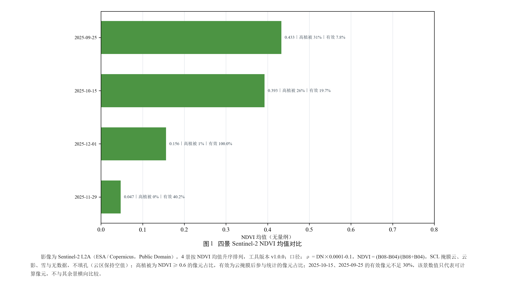

# batch-ndvi · Sentinel-2 NDVI 批量计算

对一个文件夹内的 Sentinel-2 L2A 影像批量计算 NDVI，输出逐景统计、批量清单与对比图；单景失败不影响其余景，重复运行不重复计算。



## 1. 演示结果

4 景 2025 年 Sentinel-2 L2A，4 km × 4 km 窗口，10 m 网格：

| 成像日期 | NDVI 均值 | 高植被占比（≥0.6） | 有效像元比 | 有效面积 |
|---|---|---|---|---|
| 2025-09-25 | 0.433 | 31% | 7.8% | 1.35 km² |
| 2025-10-15 | 0.393 | 26% | 19.7% | 3.41 km² |
| 2025-12-01 | 0.156 | 1% | 100% | 17.34 km² |
| 2025-11-29 | 0.047 | 0% | 40.2% | 6.96 km² |

结果的三条口径说明：

1. 9 月至 12 月的均值下降对应物候变化，同一地区年内差异不构成植被退化判断。
2. 均值的可比性取决于有效像元比。2025-09-25 云量 34%，掩膜后有效像元 7.8%；2025-10-15 红波段中位反射率 −0.033，大量像元被 L2A 的 −0.1 偏移压到负值，正性掩膜后有效像元 19.7%。两景均值只代表各自的可计算像元，摘要图中已标注该限制。
3. 不同 tile 可同批处理：48RVU 与 48RVV 各 2 景，网格一致时直接并列，网格不一致时用 `--grid-from` 对齐。

运行耗时：单景 0.1—0.2 s（本地 388 × 447 像元）；同一命令第二次运行 0 景重算、4 景跳过。

## 2. 运行

```powershell
pip install -r requirements.txt          # affine==2.3.0 为硬约束

python -m batch_ndvi --in examples/data --out examples/out --mode ndvi
python -m batch_ndvi --help
```

标准输出：

```
扫描到 4 景，未配对 0 个文件
完成 2025-09-25 … 0.12s  NDVI 均值 0.505
…
完成 4 景｜跳过 0 景｜失败 0 景｜未配对 0 个文件
清单  examples\out\manifest.json
汇总  examples\out\summary.csv
图件  examples\out\batch_summary.png（同名 .svg）
```

输出文件（均在 `--out` 目录）：

| 文件 | 内容 |
|---|---|
| `manifest.json` | 逐景状态（done/skipped/failed）、输入指纹、参数指纹、耗时、统计值 |
| `summary.csv` | 逐景一行：NDVI 均值/中位/极值、高植被占比、水体占比、有效像元比、有效面积 |
| `failures.csv` | 仅在有失败时生成：scene_id、stage、error_type、message、耗时 |
| `unpaired.csv` | 仅有配对失败时生成：文件名与未配对原因 |
| `run.log` | 逐景一行运行日志 |
| `batch_summary.png/.svg` | 逐景对比条形图，300 dpi |

复现演示数据（约 8 分钟，仅取窗口，不下载整景）：

```powershell
python scripts/select_dates.py     # STAC 查询，选取 4 个低云时相 → examples/scenes.json
python scripts/fetch_demo.py       # gdalwarp + /vsicurl 按 bbox 取窗 → examples/data/
```

## 3. 计算口径

| 项 | 取值 |
|---|---|
| 输入 | 文件夹（含子目录）内的 `.tif/.tiff`，按 `_B04`、`_B08`、`_SCL` 配对，未配对文件记入 `unpaired.csv` |
| 反射率 | `ρ = DN × 0.0001 + (−0.1)`（L2A 的 BOA 偏移），可用 `--scale/--offset` 覆盖 |
| NDVI | `(ρNIR − ρRED) / (ρNIR + ρRED)` |
| 有效像元 | `DN>0` 且 `ρred>0.002` 且 `ρnir>0.002` 且 `ρNIR+ρRED>0.002` 且 `SCL ∉ {0,1,3,8,9,10,11}` |
| 小孔填补 | 默认关闭（`--fill-max-px 0`）；开启后用邻近像元填补云区，`summary.csv` 记录 `fill_max_px` |
| 幂等 | 输入指纹（字节数与首 1 MB sha1）、参数指纹、工具版本三者一致则跳过，`--force` 强制重算 |
| 失败隔离 | 单景失败写入 `failures.csv` 一行并继续下一景，`--fail-fast` 才整体退出 |
| 退出码 | `0` 全部成功，`3` 存在失败，`2` 参数错误 |
| 并发 | `--workers N`，默认 1 |
| 网格 | 默认沿用各景原网格，`--grid-from <参考.tif>` 对齐（SCL 用最近邻） |
| 输出 | float32、`nodata=NaN`、CRS 沿用输入、`<景名>_ndvi.tif`，不覆盖输入 |

设计取舍见 [`docs/批量处理踩坑与设计.md`](docs/批量处理踩坑与设计.md)。

## 4. 目录结构

```
batch-ndvi/
├─ batch_ndvi/
│  ├─ cli.py          # 参数解析、校验与退出码
│  ├─ config.py       # 参数唯一来源：scale/offset/掩膜集合/分级/字体/版本
│  ├─ scanner.py      # 文件夹 → 景：波段配对与未配对记录
│  ├─ processor.py    # 单景处理函数，不打印、不退出，可单独调用
│  ├─ runner.py       # 编排：manifest 幂等、失败隔离、进程池、原子落账
│  └─ report.py       # summary.csv、failures.csv、批量对比图
├─ tests/             # 12 个用例，全部使用合成数据，不联网
├─ scripts/           # select_dates.py（STAC 选景）、fetch_demo.py（取窗）
├─ examples/          # scenes.json + out/（演示产出）
└─ docs/              # 设计取舍、数据来源与许可
```

## 5. 数据来源与许可

- Sentinel-2 L2A：ESA / Copernicus，Public Domain，经 Element 84 Earth Search STAC 检索，通过 AWS Open Data 的 COG 直读，无需账号。
- 代码 MIT（见 `LICENSE`），图件 CC BY 4.0。
- 影像署名：Contains modified Copernicus Sentinel data [2025], processed by ESA。
- 本图为分析图件，非标准地图、无审图号；公开发布须按《地图管理条例》送审。

## 6. 局限

1. 不含大气校正，输入须为 L2A 地表反射率产品。
2. 不做镶嵌，多景拼接涉及羽化与色彩均衡，不在本工具范围。
3. 云检测依赖 SCL（sen2cor 粗分类），薄云与云影边缘会有残留，有效像元比反映这一情况。
4. 深色地表受 L2A 的 −0.1 偏移影响，正性掩膜会判为无效（演示中 2025-10-15 有效像元 19.7%）。放宽 `--min-reflectance` 可保留暗像元，但均值会显著偏高（实测 2.6）。
5. 幂等依赖文件内容指纹与参数指纹，改动其中任一都会触发全批重算。
6. 演示数据为 4 km × 4 km 窗口，整景运行时内存与耗时按 10—20 倍估计。

## English

A CLI that walks a folder of Sentinel-2 L2A scenes (B04 red + B08 NIR + optional SCL), computes NDVI per scene, writes per-scene statistics, and renders a batch comparison chart, with an idempotent manifest, per-scene failure isolation and resumable runs.

Four 2025 scenes over a 4 × 4 km window at 10 m: NDVI mean 0.433 (2025-09-25, 7.8% valid pixels), 0.393 (2025-10-15, 19.7% valid), 0.156 (2025-12-01, 100% valid), 0.047 (2025-11-29, 40.2% valid). Runtime 0.1–0.2 s per scene; a second identical run recomputes nothing.

Reproduce with `pip install -r requirements.txt` (note `affine==2.3.0`) and `python -m batch_ndvi --in examples/data --out examples/out --mode ndvi`. Demo inputs come from `scripts/select_dates.py` and `scripts/fetch_demo.py`, which read windowed COGs over `/vsicurl` rather than full granules.

`processor.process_scene()` is a pure function; `runner` keys its manifest on input fingerprint, parameter hash and tool version, writes atomically per scene and records failures instead of aborting. Exit codes: 0 complete, 3 partial, 2 bad arguments.

No atmospheric correction (L2A only), no mosaicking, SCL is a coarse sen2cor classification, and any parameter change invalidates the manifest.
